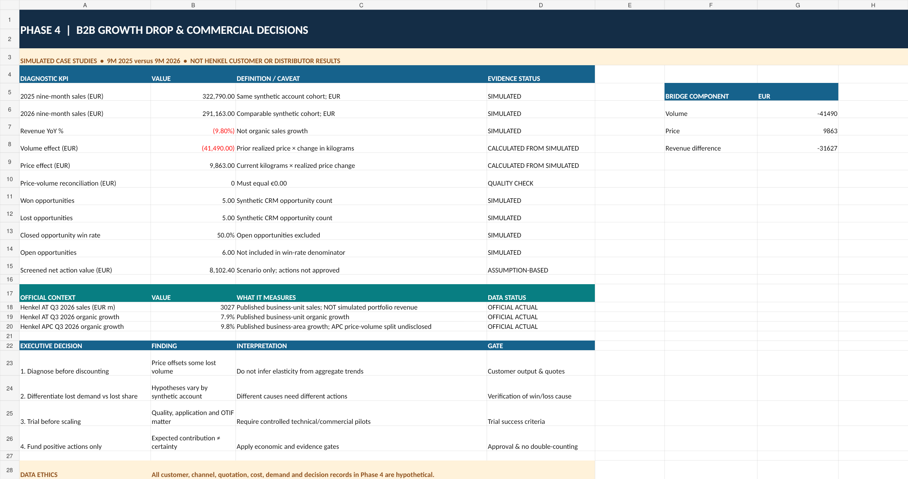
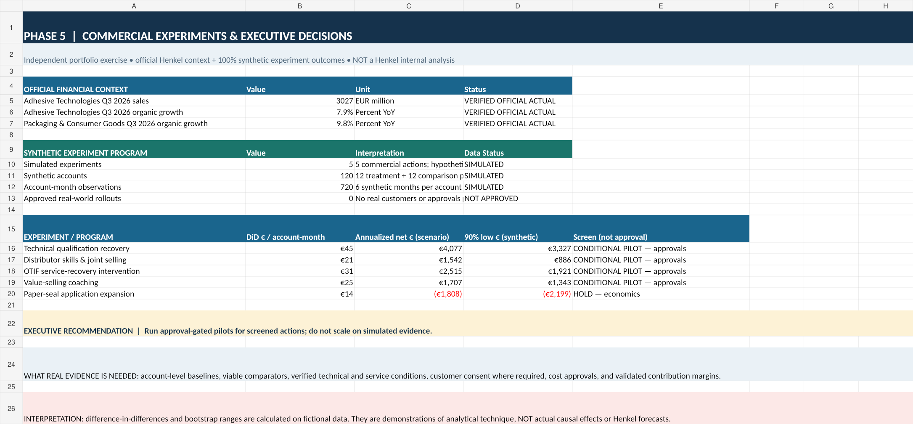

# B2B Commercial Growth & Channel Intelligence
### Henkel Adhesive Technologies / APC — independent portfolio case study

> **Independent educational project. Not commissioned by, affiliated with or endorsed by Henkel.** Company financial figures are transcribed from official public reports. **All distributor, customer, channel, customer-level pricing, win/loss and experiment data are synthetic.** No internal Henkel data or real customer trials were used.



## Business problem

**Can pricing-led organic growth remain sustainable if future growth must come increasingly from customer demand and volume?** What could a global Sales & Channel Excellence team investigate to identify *profitable* growth rather than just higher revenue?

In Henkel's **Q3 2026** published data, Adhesive Technologies reported **7.9% organic sales growth**, with **7.2 percentage points from price** and **0.7 percentage points from volume**. Packaging & Consumer Goods (APC) reported **9.8% organic sales growth**; its own price/volume split **was not disclosed**. The Q3 report was published on **10 November 2026** ([official investor event](https://www.henkel.com/investors-and-analysts/events/2026-q3)). **A large price contribution is not proof of weak demand or poor commercial execution.**

| Reported Q3 | Adhesive Technologies organic growth | Price contribution | Volume contribution | APC organic growth |
|---|---:|---:|---:|---:|
| 2024 | +3.7% | −0.2 pp | +3.9 pp | +2.7% |
| 2025 | +2.5% | +0.5 pp | +2.0 pp | −1.1% |
| 2026 | +7.9% | +7.2 pp | +0.7 pp | +9.8% |

Source: official Henkel Q3 statements (direct links and source pages in [`data/official_financials/`](data/official_financials/) and [`Phase 1 brief`](reports/research/Phase1_Commercial_Growth_Research_Brief.md)). Numbers are percentage-point contributions, *not* growth shares or customer transaction data.

## Project architecture — five research phases

| Phase | Business decision | Technical demonstration | Project assets |
|---|---|---|---|
| **1 — Financial growth quality** | Is growth price-led, volume-led or mixed? | Source-linked quarterly comparisons; reporting controls | [Research brief](reports/research/Phase1_Commercial_Growth_Research_Brief.md), [notebook](notebooks/01_growth_quality.ipynb) |
| **2 — Market opportunity** | Which demand and product-application hypotheses deserve investigation? | Footwear & packaging market evidence, scenario economics | [Research brief](reports/research/Phase2_Commercial_Market_Research_Brief.md), [notebook](notebooks/02_market_opportunities.ipynb) |
| **3 — Account intelligence** | Which manufacturers qualify for further desk research? | Sourced manufacturing footprints, unknown-supplier gates | [Research brief](reports/research/Phase3_Customer_Competitor_Intelligence_Brief.md), [notebook](notebooks/03_customer_intelligence.ipynb) |
| **4 — Sales diagnostics** | What explains fictional customer-volume losses? | Reconciled price-volume bridge, win/loss, action economics | [Research brief](reports/research/Phase4_Sales_Excellence_Case_Brief.md), [notebook](notebooks/04_sales_diagnostics.ipynb) |
| **5 — Commercial experiments** | Which hypothetical actions would pass a screening gate? | Seeded panel, pre/post vs comparison group, contribution ROI | [Research brief](reports/research/Phase5_Executive_Research_Brief.md), [notebook](notebooks/05_commercial_experiments.ipynb) |

### Example of the simulated diagnostic

Across eight fictional manufacturing accounts in Phase 4, the model computes a **−€41,490** volume effect and **+€9,863** price effect (approximately), resulting in a **−€31,627** sales change. The bridge reconciles mathematically; it does **not** establish why real customer demand changes. Phase 5 evaluates five fictional interventions, with four screening positive and one screening negative on the model's own assumptions. **None represents an actual experiment, approved action or Henkel financial forecast.**



## Technology

- **Python 3.10+ (standard library)** — reproduces channel scorecards, simulated price-volume diagnostics and seeded commercial experiments; [source code](src/).
- **Excel** — [complete research and analytics workbook](dashboards/excel/Henkel_APC_Complete_Portfolio_Phase5.xlsx), including every earlier research phase and explicit `Data_Status`/source fields.
- **Power BI** — [DAX measures, import instructions and six-page dashboard blueprint](dashboards/powerbi/README.md). **No `.pbix` is included**; visuals shown above are static previews, not screenshots of a finished Power BI model.
- **Jupyter notebooks** — five small, runnable study cases using bundled CSV files, with no saved output cells.

## Quick start

```bash
# Python 3.10+; clone or unzip and open terminal in project root
python scripts/validate_repository.py
python scripts/reproduce_all.py
python -m unittest discover -s tests -v
```

Reproduced results appear in `outputs/` (ignored by Git). You do not need a Henkel account or proprietary software to run the Python analyses. See [reproducibility guide](docs/reproduce.md) and [data dictionary](docs/data_dictionary.md).

## Project organization

```text
├── data/
│   ├── official_financials/    # Issuer-reported figures, dates, sources
│   ├── desk_research/         # Public market and manufacturer research
│   ├── assumption_models/     # Hypothetical whitespace scenarios
│   └── synthetic/             # Fictional channel, diagnostic, pilot data
├── src/                        # Reproducible Python analysis engines
├── notebooks/                  # Five study notebooks
├── dashboards/                 # Excel workbook + Power BI DAX/blueprints
├── reports/                    # Source-cited briefs and executive deck
├── docs/                       # Data dictionary, methods and publishing
├── tests/                      # Provenance and arithmetic checks
└── .github/workflows/          # Standard-library CI checks
```

## Research standards and limitations

- Reported **AT** price/volume contributions must **not** be described as APC-specific.
- The presence of named factories in public documents is not evidence that they are Henkel customers or qualified opportunities.
- Scenario market values are assumptions, not reported target-market sales or actual pipeline.
- Synthetic channel and experiment records cannot be used to infer Henkel's real internal performance.
- Margin comparisons must respect H1/FY periods; Q3-only/APC margins are not fabricated.
- Financial and market sources have different units and coverage; read the source register before making comparisons.

Read the [full disclaimer](DISCLAIMER.md), [data dictionary](docs/data_dictionary.md), and [publication checklist](docs/publish_checklist.md). Source documents are **linked**, not bundled, to respect publisher rights.

## Executive presentation

The [12-slide strategy deck](reports/executive/Henkel_APC_Executive_Strategy_Simulation.pptx) and [portfolio interview pitch](docs/interview_pitch.md) explain the decision questions and where real data/approvals would be required.

**License:** MIT for original code/documentation only; external company marks and third-party content are excluded.
